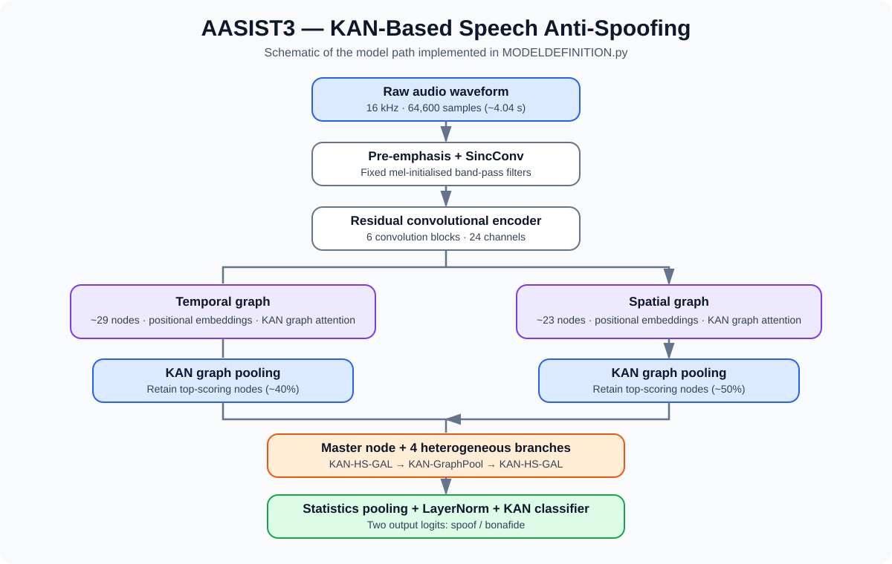
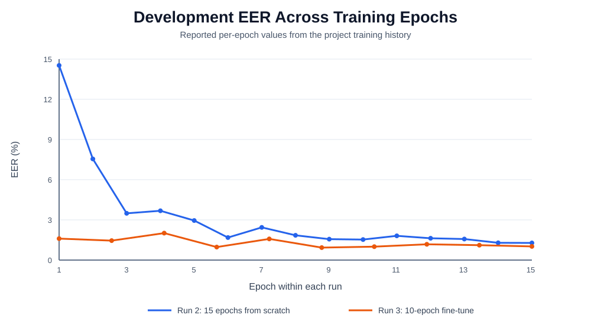

# AASIST3: KAN-Based Speech Anti-Spoofing



*Model architecture: waveform preprocessing, residual encoder, temporal/spatial graph branches, KAN graph modules, and spoof/bonafide classifier.*



*Training plot uses the per-epoch development EER values listed in this README; the fine-tuning run has 10 epochs.*

A PyTorch implementation of **AASIST3**-style speech deepfake detection: a graph-attention anti-spoofing model (after AASIST) in which the attention, pooling and classifier layers use **Kolmogorov-Arnold Network (KAN)** components. It takes a raw waveform and classifies it as **bonafide** or **spoof**, trained and evaluated on **ASVspoof 2019 Logical Access (LA)**.

## Results at a glance

| Model                                     | Dev EER   | Eval EER  | Eval ROC-AUC |
| ----------------------------------------- | --------- | --------- | ------------ |
| Stage 1: 15 epochs from scratch           | 1.28%     | 1.83%     | 0.9966       |
| **Stage 2: +10 epochs fine-tune (final)** | **0.93%** | **1.47%** | **0.9983**   |

- 461,602 parameters (about 6 MB checkpoint)
- Eval: all 71,237 clips of the official LA eval split (7,355 bonafide / 63,882 spoof)
- Checkpoints chosen by **dev EER only**; the eval split was scored once per checkpoint
- Total compute: about 15.2 GPU-hours on Kaggle

> **Read this before comparing numbers.** Scores use only the first \~4 s of each clip and no min t-DCF, so they are not directly comparable to published full-utterance results. This is a research prototype and not an exact reproduction of AASIST or AASIST3. See Limitations.

## Contents

- Why KANs?
- Architecture
- Dataset
- Repository structure
- Setup
- Training
- Evaluation
- Results in detail
- Limitations
- Roadmap
- Acknowledgements

## Why KANs?

Standard layers combine a learned linear map with a fixed activation. KANs instead place **learnable univariate functions** (spline-based in [`efficient-kan`](https://github.com/Blealtan/efficient-kan)) on the connections. Here, KAN components are used in the graph-attention layers, the graph-pooling scorers and the output classifier, to test whether these learnable nonlinearities help detect spoofed speech. The numbers above show the model trains well on LA; whether KANs are the reason is **not** established without an ablation (see Roadmap).

## Architecture

The model processes a fixed-length raw waveform and combines temporal and spatial graph representations.

text

```text
Raw waveform (16 kHz, 64,600 samples, about 4.04 s)
        |
Pre-emphasis: x[n] - 0.97 * x[n-1]
        |
Fixed SincConv front end (70 non-trainable mel-initialised band-pass filters)
        |
abs -> 2-D MaxPool (3x3) -> BatchNorm2d -> SELU
        |
Residual encoder: 6 conv blocks (24 channels out)
        |
        +--------------------------+
        |                          |
max over frequency + pos. emb.   max over time + pos. emb.
Temporal graph (~29 nodes, 24-d) Spatial graph (23 nodes, 24-d)
        |                          |
   KAN graph attention        KAN graph attention
        |                          |
   KAN graph pooling (40%)    KAN graph pooling (50%)
        +------------+-------------+
                     |
           Learnable master node
                     |
   4 parallel heterogeneous branches:
   KAN-HS-GAL -> KAN-GraphPool -> KAN-HS-GAL
                     |
   Residual aggregation (averaged over branches)
                     |
   Dropout + statistics pooling -> LayerNorm
                     |
   KAN classifier (grid range [-3, 3])
                     |
   Two logits: [spoof, bonafide]
```

**Components**

- **Pre-emphasis + SincConv:** high-frequency boost, then a fixed mel-initialised filter bank, as in the AASIST3 paper.
- **Residual encoder:** six conv blocks producing a 24-channel map; its frequency axis forms the spatial graph and its time axis the temporal graph.
- **KAN-GAL / KAN-HS-GAL:** graph attention with KAN projections; HS-GAL attends across temporal and spatial nodes with a shared master node.
- **KAN-GraphPool:** keeps the top-scoring nodes using a learned KAN scorer.
- **Classifier:** KAN layer producing two logits.

The graphs are small (about 23 spatial and 29 temporal nodes), so dense pairwise attention is cheap. The active implementation is `MODELDEFINITION.py`; its settings live in `DEFAULT_D_ARGS`, shared by training, evaluation and tests.

**Differences from the paper:** HS-GAL layers keep a 24-d node width (`gat_dims[1]` unused); KAN layers use `efficient-kan` defaults; the readout averages branch outputs and adds a LayerNorm before the classifier for numerical stability.

## Dataset

**ASVspoof 2019 LA.** Not included in this repo; obtain it from the [official ASVspoof resources](https://www.asvspoof.org/) or an authorised source and follow its terms.

| Split | Clips  | Bonafide | Spoof  |
| ----- | ------ | -------- | ------ |
| Train | 25,380 | 2,580    | 22,800 |
| Dev   | 24,844 | 2,548    | 22,296 |
| Eval  | 71,237 | 7,355    | 63,882 |

Only about 10% of clips are bonafide, so accuracy is misleading; **EER and ROC-AUC** are the metrics to read. The official eval split also contains attack algorithms that do not appear in train or dev, so eval EER is a real generalization test, not a repeat of dev.

Expected layout:

text

```text
LA/
├── ASVspoof2019_LA_train/flac/
├── ASVspoof2019_LA_dev/flac/
└── ASVspoof2019_LA_cm_protocols/
    ├── ASVspoof2019.LA.cm.train.trn.txt
    └── ASVspoof2019.LA.cm.dev.trl.txt
```

Audio must be 16 kHz; clips are prepared as 64,600 samples (`DATAUTLIS.py`). Download with `python DATASET_Download.py` (unpacks to `./LA`), or attach the dataset as Kaggle notebook input. If auto-discovery fails, set `DATASET_ROOT`.

## Repository structure

| File                                                      | Purpose                                                                       |
| --------------------------------------------------------- | ----------------------------------------------------------------------------- |
| `TRAIN.py`                                                | Training loop, dev evaluation, logging, checkpointing (`best.pt`, `last.pt`). |
| `MODELDEFINITION.py`                                      | Active model: SincConv front end, encoder, graph layers, classifier.          |
| `DATAUTLIS.py`                                            | Protocol parsing, audio preprocessing, dataset utilities.                     |
| `DATASET_Download.py`                                     | Dataset download and extraction helper.                                       |
| `EVAL.py`                                                 | Scores the LA eval (or dev) split with a checkpoint; reports EER and ROC-AUC. |
| `SMOKE_TEST.py`                                           | Synthetic-input forward/backward and output-validity checks.                  |
| `requirements.txt`                                        | Dependencies.                                                                 |
| `.github/workflows/model-smoke-test.yml`                  | CI smoke test.                                                                |
| `FULL_TRAINING_GUIDE.md`                                  | Kaggle training workflow.                                                     |
| `results/`                                                | Per-epoch training logs and final metrics (see below).                        |
| `KAN_GRAPH_MODULES.py`, `SINCCONVENCODER.py`, `MODELS.py` | Modular / compatibility files; the active path is `MODELDEFINITION.py`.       |

## Setup

Python 3 and `requirements.txt`. A CUDA GPU is recommended.

bash

```bash
git clone https://github.com/gladiator456/aasist3.git
cd aasist3
python -m venv .venv && source .venv/bin/activate   # Windows: .venv\Scripts\Activate.ps1
python -m pip install --upgrade pip
pip install -r requirements.txt
python SMOKE_TEST.py
```

The smoke test only confirms the model runs (forward/backward, output shape, numerical validity) on synthetic input. It does not test data loading, memory use, convergence or detection quality. For GPU training, install a PyTorch build matching your CUDA version.

## Training

Defaults: 25 epochs, batch size 8, Adam, base LR 1e-4 with 500-step linear warm-up then cosine decay, seed 42, mixed precision off. Do a short trial first:

bash

```bash
MAX_TRAIN_SAMPLES=2000 MAX_DEV_SAMPLES=1000 NUM_EPOCHS=2 BATCH_SIZE=2 LOG_EVERY=50 python TRAIN.py
```

### Reproducing the reported results

**Stage 1: 15 epochs from scratch**

bash

```bash
NUM_EPOCHS=15 BATCH_SIZE=16 CHECKPOINT_DIR=checkpoints_full python TRAIN.py
```

**Stage 2: 10 more epochs, weights only (fresh optimizer and LR schedule)**

bash

```bash
INIT_FROM=checkpoints_full/best.pt NUM_EPOCHS=10 BATCH_SIZE=16 BASE_LR=3e-5 \
CHECKPOINT_DIR=checkpoints_ext python TRAIN.py
```

Runs on Kaggle take about 1,900-2,000 s per epoch (batch 16).

### Configuration

| Variable                                            | Purpose                                                                                                                                                                 |
| --------------------------------------------------- | ----------------------------------------------------------------------------------------------------------------------------------------------------------------------- |
| `DATASET_ROOT`                                      | Dataset root directory.                                                                                                                                                 |
| `NUM_EPOCHS`, `BATCH_SIZE`                          | Epochs and batch size.                                                                                                                                                  |
| `BASE_LR`                                           | Peak LR (default `1e-4`).                                                                                                                                               |
| `OPTIMIZER`                                         | `adam` (default, as in the paper) or `adamw`.                                                                                                                           |
| `WARMUP_STEPS`                                      | Linear warm-up steps before cosine decay (default `500`).                                                                                                               |
| `USE_AMP`                                           | Opt-in mixed precision (off by default for KAN numerical stability).                                                                                                    |
| `SEED`, `NUM_WORKERS`                               | Seed (default `42`) and DataLoader workers (default `2`).                                                                                                               |
| `CHECKPOINT_DIR`                                    | Where checkpoints are written (default `./checkpoints`).                                                                                                                |
| `INIT_FROM`                                         | Load model weights only; fresh optimizer and schedule. Not combinable with `RESUME_FROM`.                                                                               |
| `RESUME_FROM`                                       | Restore full training state (`auto` uses `CHECKPOINT_DIR/last.pt`, or give a path).                                                                                     |
| `STOP_AFTER_EPOCH`                                  | Pause cleanly after this epoch; the LR schedule still spans `NUM_EPOCHS`. Resume with `RESUME_FROM=auto` and the same `NUM_EPOCHS` to split a long run across sessions. |
| `MAX_TRAIN_SAMPLES`, `MAX_DEV_SAMPLES`, `LOG_EVERY` | Quick-trial limits and log interval.                                                                                                                                    |

`last.pt` (model, optimizer, scheduler, scaler, best dev EER) is saved every epoch, so an interrupted run can continue with `RESUME_FROM=auto python TRAIN.py`. See `TRAIN.py` for current defaults.

## Evaluation

`TRAIN.py` picks `best.pt` by dev EER, so the dev EER it prints is optimistic. Report the held-out eval number instead:

bash

```bash
DATASET_ROOT=/path/to/LA CHECKPOINT=checkpoints_ext/best.pt python EVAL.py
```

`EVAL.py` reports EER and ROC-AUC on the first \~4 s of each clip and writes per-clip scores to a text file. Min t-DCF is not computed because it needs the official ASV score files.

## Results in detail

### Training history

| Run | Model                                         | Setup                                                             | Best dev EER                               | Eval EER / AUC     | Wall time               |
| --- | --------------------------------------------- | ----------------------------------------------------------------- | ------------------------------------------ | ------------------ | ----------------------- |
| 1   | Earlier encoder-less model (commit `21d1c66`) | 12 epochs, batch 8, AdamW, lr 1e-4                                | 14.57% (epoch 10); dev AUC peaked at 0.928 | not run            | n/a                     |
| 2   | Current model (commit `007ad23`)              | 15 epochs, batch 16, Adam, lr 1e-4                                | 1.28% (epoch 15)                           | 1.83% / 0.9966     | **33,248.8 s** (9.24 h) |
| 3   | Run 2 weights, fine-tuned (commit `15c280b`)  | +10 epochs, batch 16, Adam, lr 3e-5, fresh optimizer and schedule | **0.93%** (epoch 6)                        | **1.47% / 0.9983** | **21,485.7 s** (5.97 h) |

Wall times include startup, training and the final eval pass.

- **Run 1 to 2:** adding the paper's residual encoder, pre-emphasis and positional embeddings took best dev EER from 14.57% to 1.28%. Run 1 plateaued from epoch 7.
- **Run 2 to 3:** continuing at a lower LR reduced eval EER from 1.83% to 1.47% and AUC from 0.9966 to 0.9983. Run 2's best checkpoint was its final epoch, so it had not clearly converged.

### Dev EER per epoch (%)

- **Run 2:** 14.53, 7.55, 3.49, 3.68, 2.95, 1.68, 2.44, 1.85, 1.56, 1.53, 1.81, 1.63, 1.57, 1.29, **1.28**
- **Run 3:** 1.60, 1.45, 2.01, 0.97, 1.58, **0.93**, 1.00, 1.18, 1.11, 1.02

Dev EER moves by roughly 0.3-0.5 points between neighboring epochs in run 3, so epoch 6 is within noise of epochs 4, 7 and 10. The reliable signal is the shift from about 1.3-1.6% to about 1.0%.

### Best checkpoint (run 3, epoch 6, dev)

|                     | Predicted spoof | Predicted bonafide |
| ------------------- | --------------- | ------------------ |
| **Actual spoof**    | 22,204          | 92                 |
| **Actual bonafide** | 43              | 2,505              |

Recall: spoof 0.9959, bonafide 0.9831. Dev ROC-AUC 0.9992.

Full per-epoch tables (loss, accuracy, EER, AUC, confusion matrices, timings) for runs 2 and 3: `results/aasist3_training_results.txt`.

## Limitations

- **Not comparable to published numbers.** Only the first \~4 s of each clip is scored, and min t-DCF is not computed. For context, the original AASIST paper reports 0.83% EER on LA eval with full-utterance scoring, so this implementation does **not** match it. The AASIST3 paper's own results (t-DCF 0.5357, EER 22.67%, closed condition) are on ASVspoof 2024, a much harder set.
- **Single seed.** Epoch-to-epoch dev noise is about 0.3-0.5 points; small differences between checkpoints are not significant.
- **Checkpoint selected on dev.** Dev EER is optimistic; the eval split was scored once per checkpoint, never used for selection.
- **Training instability.** Occasional gradient-norm spikes (up to about 110) appear in all runs; no gradient clipping is applied.
- **In-domain only.** No cross-dataset evaluation (ASVspoof 2021, In-the-Wild) has been done.
- **No ablation yet.** The contribution of KAN layers, pre-emphasis and the encoder is not isolated.

## Roadmap

- &#x20;Model implementation, data utilities, training and evaluation code
- &#x20;Synthetic-input smoke test and CI workflow
- &#x20;Full real-data training on ASVspoof 2019 LA (runs 2 and 3)
- &#x20;Held-out eval-split results (EER, ROC-AUC) and training logs
- &#x20;Score overlapping 4 s windows across the full clip and average
- &#x20;Gradient clipping to stabilize training
- &#x20;Ablations: KAN vs. standard layers, pre-emphasis on/off, encoder variants
- &#x20;Multiple seeds with confidence intervals
- &#x20;Cross-dataset evaluation (ASVspoof 2021, In-the-Wild)
- &#x20;Min t-DCF using the official ASV score files
- &#x20;Publish `best.pt` as a GitHub Release asset
- &#x20;Small CLI for scoring individual audio files

## Acknowledgements

- **AASIST:** Jung et al., *AASIST: Audio Anti-Spoofing using Integrated Spectro-Temporal Graph Attention Networks*. Parts of the data utilities derive from the AASIST codebase; see source files for attribution and licence details.
- **AASIST3:** Borodin et al., *AASIST3: KAN-Enhanced AASIST Speech Deepfake Detection using SSL Features and Additional Regularization for the ASVspoof 2024 Challenge*.
- **KAN:** Liu et al., *KAN: Kolmogorov-Arnold Networks*.
- **efficient-kan:** [Blealtan/efficient-kan](https://github.com/Blealtan/efficient-kan).
- **ASVspoof 2019 organisers:** for the dataset and challenge resources.

Review licences and attribution requirements for all reused code, dependencies and data before redistribution.

## Author

**Anuj Saxena** B.Tech, Chemical Engineering, IIT Jammu